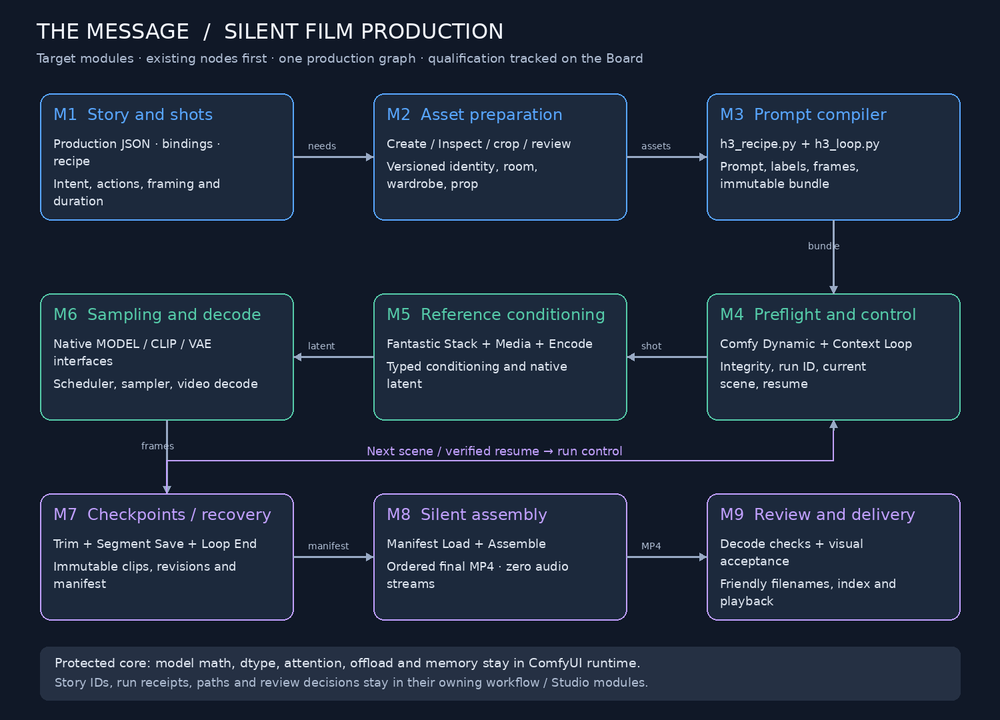
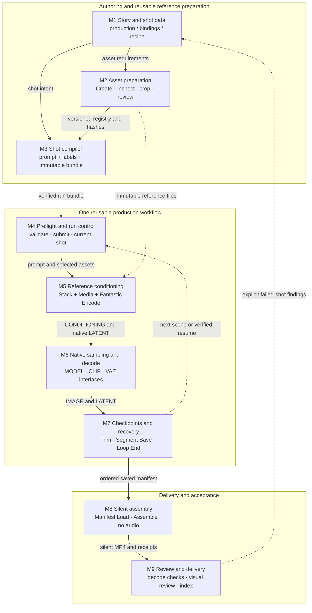

# The Message — production modules

Target architecture for the silent-film proof, not a claim that every module is
already qualified. The existing two-shot test proves a subset of the generation,
checkpoint and assembly path. Numbered Board cards track the remaining work.

## Module ownership and interfaces

| Module | Owns | Existing implementation / planned owner | Board |
| --- | --- | --- | --- |
| M1 Authoring | Script, entities, shots, framing, duration and silence intent | `studio/projects/the-message/`, existing production validator | T03 |
| M2 Assets | Source provenance, crops, RefMod metadata, review state | Separate reference workflow; Fantastic Create/Inspect; `assets.json` and review record | T02; N28–N29 |
| M3 Compiler | Reference labels, structured prompts, frame alignment, complete recipe bundle | `studio/h3_recipe.py`, `studio/h3_loop.py` | T03–T04 |
| M4 Run control | File integrity, effective graph contract, resources, prompt IDs, current scene | Comfy Dynamic + Context Loop Plan/Profile/Start/Current; planned `studio/h3_loop_run.py` | T05–T07 |
| M5 Conditioning | Selected reference encoding, typed conditioning and starting latent | Fantastic RefModStack / MediaLoader / TextEncode / ReferenceMap | N07, N09–N11, N21, N26; T08 |
| M6 Inference | Model loading/patches, sampling and decoded images | Native UNET/CLIP/VAE loaders, SigmaShift, BasicGuider/Scheduler, RandomNoise, SamplerCustomAdvanced, VAEDecode | N02–N06, N12–N18; T07 |
| M7 Persistence | Delivered scene frames, immutable revisions and continuation checkpoints | Context Loop Trim / SegmentSave / LoopEnd / ManifestLoad | N37–N39, N41–N43; T06/T10 |
| M8 Assembly | Ordered joining and explicit no-audio final MP4 | Context Loop Assemble; FFmpeg verification | N40; T04/T09/T10 |
| M9 Acceptance | Complete decode, visual findings, friendly copies, index and final selection | Existing probes plus planned loop adapter; user review; panel media display | T09/T11/QA |

This diagram separates responsibilities, not nine new node packs or nine new
workflows. Use two saved workflows: Reference Preparation and Silent Film
Production. Show modules initially as clean groups; optional subgraphs come only
after stable named input/output contracts are verified. Group rectangles are
geometric and do not establish execution isolation.

## ComfyUI boundaries

1. Use existing native `MODEL`, `CLIP`, `VAE`, `CONDITIONING`, `LATENT` and `IMAGE`
   contracts where they fit. Keep the installed H3-specific reference/chain types
   at the adapters that own them. Preserve H3's native audiovisual latent shape
   even when final delivery is silent.
2. Keep story IDs, output paths, manifests, approval and UI state in Studio or
   workflow/persistence nodes. Do not push them into `comfy/` model classes,
   shared attention helpers or `execution.py`.
3. Keep dtype, offload and model memory management in ComfyUI's existing runtime.
   Comfy Dynamic parses deterministic project data; it does not manage VRAM,
   monkeypatch models or submit nested HTTP queue jobs.
4. Context Loop owns recursive graph execution. ComfyUI node expansion gives
   each expanded node normal execution/caching; it is the supported mechanism
   behind loops, rather than scripting repeated sampler calls inside a node.
5. Treat execution control as real dependencies. Audit optional and lazy inputs;
   disconnect unwanted audio dependencies before muting their producers. A muted
   branch can disable consumers and is not equivalent to a runtime selector.
6. Keep preparation out of the per-shot loop. Reference crops and RefMods are
   versioned once; scene data selects the required immutable versions.
7. Keep final silence explicit at assembly and verify zero audio streams. Internal
   model audio computation and exported audio are distinct contracts.
8. Reuse existing nodes first. If a missing behavior truly needs a new node,
   apply this checkout's V3 schema and narrow layer-ownership rules; do not create
   a new abstraction merely to match a diagram box.

## Cleanup boundary

Task T12 audits each candidate before removal:

`inventory → cross-workflow dependency map → retained/removable/unknown → recovery record → scoped removal → regression check`.

- **Keep for this route:** native model/sampler/decode nodes, Fantastic reference
  tools, Context Loop and the used Comfy Dynamic nodes.
- **Remove from the production working copy after replacement passes:** duplicate
  prompt/duration/resolution controls, old manual save path, unnecessary audio
  decode dependencies and reference-creation outputs inside generation.
- **Audit before uninstall:** unused third-party packs, frontend extensions and
  duplicate Studio code. Absence from this canvas does not prove global disuse.
- **Preserve:** model files, source/reference assets, outputs, checkpoints, dirty
  work, other users' saved workflows and dependencies needed for recovery.

No installed pack is labelled safe to uninstall solely by this architecture.
The Board separates inventory, removal and regression evidence.

## Board operating rules

Initiative: **The Message · Silent Film Production**.
`Txx` = phase, `Txx.yy` = subtask, `Nxx` = individual node audit under T01.02,
`QA.xx` = final acceptance. The API has flat cards: these stable IDs and the
manifest express hierarchy/dependencies; the board does not enforce dependency
scheduling automatically. A phase is done only when its subtasks and stated
gate pass. A node audit being done does not mean its planned replacement shipped.

Full card scope and dependency text are retained in
`.codex/artifacts/the-message-production/silent-proof-v001/board-manifest.json`;
Board summaries are bounded to 280 characters. Every card links the common
production thread where the plan and readable task register are attached.

## Sources checked

- This checkout's [AGENTS.md](../../AGENTS.md): core/model boundaries, reuse of
  native interfaces, memory management ownership and minimal node additions.
- Official [node expansion](https://docs.comfy.org/custom-nodes/backend/expansion)
  and [lazy evaluation](https://docs.comfy.org/custom-nodes/backend/lazy_evaluation),
  retrieved through Context7 during this board setup.
- Official [subgraphs](https://docs.comfy.org/interface/features/subgraph): reusable
  graph packaging; no automatic conversion of this live graph was performed.
- Installed Context Loop and Fantastic source contracts inspected during the
  preceding plan audit; their qualification gates remain in the implementation plan.
