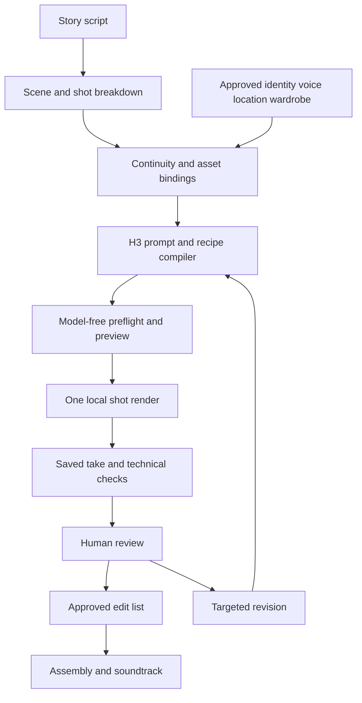

# The Message production automation plan

Prepared 2026-11-10. Proposal for the existing local ComfyUI production workspace.

The two scenes establish a usable render recipe. The next milestone is to turn a story into explicit shot records, resolve each shot against approved assets, compile its H3 prompt, and generate reviewable takes through the existing canvas. Preserve the working Fantastic RefMod pipeline while adding production controls around it. Continuous-shot extension is a later, separately qualified capability.

## What was inspected

Live canvas inspection covered **The Message – Scene 01**, **The Message – Scene 02**, **MMH3 RefMod – Complete Local Pipeline**, and **00 – Create Apartment Asset**. Both scene graphs and the base pipeline contain 26 nodes; the apartment graph contains eight. No scene nodes were muted or bypassed. Scene 02 and the apartment tab already had unsaved changes. Those changes were preserved and Scene 02 was restored as the active tab.

The connected backend reported ComfyUI 0.44.2, frontend 1.57.6, Python 3.13.14, and PyTorch 2.14.1+cu130. At inspection the queue was empty, free VRAM was approximately 1.3 of 5.7 GB reported usable, and free RAM was 15.4 GB. Port 8188 belonged to PID 268448, running this checkout's `.venv/bin/python main.py`. The checkout was `master` at `561cf1e4d56ea8b53b8772be6913bbe2ede3b179`, with existing uncommitted work.

Installed-pack inspection and targeted live `/object_info` searches confirmed the node families discussed below. This is a focused production audit, not a generation qualification of every installed extension. No rendering, model loading, downloading, installation, restart, or workflow save was performed for this plan.

## The existing render recipe

| Stage | Nodes actually used | Assessment |
| --- | --- | --- |
| Model stack | `UNETLoader`, `CLIPLoader`, two `VAELoader`, `MiniMaxH3SigmaShift` | Keep the REF2VA INT8 diffusion model, Qwen3-VL 32B NVFP4 encoder with type `minimax`, video INT8 VAE, and audio FP32 VAE. Preserve shifts 12 video / 3 audio. |
| Identity and voice | `MiniMaxH3RefModStack` | Scene 01 selects the identity RefMod. Scene 02 selects identity plus the standalone voice, once each at strength 1. Creation is correctly outside the shot render path. |
| Location and clothes | `MiniMaxH3MediaLoader` | Scene 01 uses the room; Scene 02 adds the wardrobe crop. These are ordinary picture references, not location/wardrobe RefMods. Keep that distinction in the asset register. |
| Prompt | `MiniMaxH3PromptBuilder` | Already uses structured REF sections and named reference labels. The missing piece is a compiler from shot records into its editor state and committed prompt. |
| Reference check | `MiniMaxH3FantasticReferenceMap`, two `PreviewAny` | Keep this inexpensive check before encoding. It must receive exactly the same reference/mod bundles as Text Encode. |
| Shape and timing | `ResolutionSelector`, `PrimitiveFloat`, `ComfyMathExpression` | 0.2 MP, 16:9 preference, multiple 32; two requested seconds become 56 frames. Record actual 608×352 and 56/24 = 2.333 seconds. |
| Conditioning and sampling | `MiniMaxH3FantasticRefModTextEncode`, `BasicGuider`, `BasicScheduler`, `KSamplerSelect`, `RandomNoise`, `SamplerCustomAdvanced` | Keep SA solver, beta, 20 steps, denoise 1 and seed 0 for baseline comparisons. This guider does not expose the SD1.5-style CFG setting. |
| Delivery | `VAEDecode`, `VAEDecodeAudio`, `MiniMaxH3FantasticEditComposite`, `CreateVideo`, `SaveVideo` | Saved MP4 is already present. Edit Composite is a pass-through without an edit source; it is not performing a continuity or face correction in these scenes. |

The inactive-looking Text Encode widgets showing 1344×768 / 124 frames are **link-overridden defaults**, not the effective output settings. Automation must resolve connected inputs, never read these stale widgets as the actual render budget.

The source implementation of `MiniMaxH3PromptBuilder.build()` returns `prompt_text.strip()`. It uses `builder_state` for mode/routing; changing editor JSON alone does not regenerate the final prompt. A compiler must update and roundtrip both together.

## Assets and quality findings

| Asset | Current evidence | Improvement |
| --- | --- | --- |
| Andre identity | Stack advertises `refmod-Andre_Athar`, 7,104 visual tokens. Existing production report describes eight source images stored as a photo-stack/video-kind RefMod. | Preserve this baseline. Resolve the actual selected file and metadata before each run; widget token counts can be stale. Create separately named candidates for any reduced set or compression comparison. |
| Voice | `The_Message/Andre_Athar_voice_v1`, advertised 8 seconds / 640 tokens. Earlier report records user approval of the standalone voice test. | Separate voice-reference approval from approval of each newly generated spoken line. Record source excerpt, sample format, transcript when listening-confirmed, and RefMod version. |
| Apartment | Viewed the actual 768×432 reference: cream walls, wood floor, glass doors, daylight; no desk or note. | Keep as the approved location appearance. Add a proposed floor-plan description, camera positions, lighting direction, and separately approved desk/note references when needed. A single image does not establish consistent unseen geometry. |
| Wardrobe | Viewed the actual 182×107 chest crop: dark jacket over gray crew-neck shirt. | Adequate as a coarse color/shape cue; too small to establish fabric, seams, full fit, trousers or shoes. Obtain a better candidate from original material or an approved still; keep the crop until a replacement is accepted. Upscaling alone does not establish missing details. |
| Scene 01 | Existing receipt reports 608×352, 56 frames, 20 steps, seed 0, approximately 9m44s. The user accepted it as a local baseline. | Preserve its output and recipe as the regression case. Do not retroactively alter its wardrobe/reference package. |
| Scene 02 | Existing receipt reports the same shape and timing, approximately 10m32s. Its contact sheet was inspected again: the mouth opens in a sampled frame. | Keep continuity, listening, and take acceptance pending. A voiceover prompt is not a mouth-lock mechanism. |

The historical execution times above were read from retained reports; they were not re-benchmarked. Full motion playback and fresh listening were not performed in this audit.

`stack_pictures=every 4th` selects picture indices 0, 4, ... for the text encoder. For eight stored pictures that is two presented pictures. The RefMod conditioning block is built separately; this setting does **not** reduce its saved latent token count. `stack_pictures_n=8` matters in `up to N` mode, not the current mode. Compare presentation coverage and latent-size reduction as separate experiments.

For identity candidates, review view coverage, sharpness, lighting, occlusion and conflicting clothes/backgrounds. Decode candidates with RefMod Inspect and save contact sheets. For voice, listen for clipping, noise, competing speakers and suitability of the excerpt. For location and wardrobe, review coverage of what the script will show. Store technical results separately from human acceptance.

## Useful installed nodes outside the two scenes

| Capability | Candidate nodes already available | Use and qualification boundary |
| --- | --- | --- |
| Asset preparation | `MiniMaxH3FantasticRefModCreate`, `...RefModEdit`, `...RefModInspect`, `...RefModStoreFrames` | Use in separate asset workflows. Voice-only creation accepts the audio VAE without diffusion or text encoder. StoreFrames writes to references and should be a deliberate migration, not an automatic prerequisite. |
| Masked reference preparation | `MiniMaxH3FantasticObjectMask`, `...VideoEditLatent` | Optional SAM/crop preparation when background contamination or a specific edit warrants it. Keep outside normal shot renders; inspect masks before creating a new identity asset. |
| Persistent names and prompt text | `MiniMaxH3FilenamePrefix`, `LC123SaveText` | Add to a working automation copy to record project/scene/shot/take names and the exact compiled prompt. Resolve date tokens before a wired prefix reaches SaveVideo. |
| Structured still prompts | `LCSubject`, `LCCamera`, `LCSceneBuilder`, `LCColorPalette`, `LCPromptAssembler` | Source classes exist in the installed LC123 pack; a prior local utility test covers assembly/palette. Useful for concept stills. They do not replace H3's structured REF prompt format. |
| Script file and route selection | `DynamicLoadTextFileNode`, `DynamicSwitchAnyNode`, `DynamicUniversalSelector` | Read committed prompt text; use a lazy switch for a tested route. File-loader error output must not become a blank valid prompt. A model-name selector does not guarantee model-family compatibility. |
| Resource controls | `comfyui_dynamic` monitor | Keep as the operator's model/resource view. No Dynamic nodes are required on these canvases. Native ComfyUI dynamic VRAM is the mechanism visible in current model-loading logs. |
| Timeline and shot plans | `MiniMaxH3ChainPlanStudio`, `MiniMaxH3ChainPreflight`, `MiniMaxH3GenerationProfile`, `MiniMaxH3ChainRunManager` | Strong candidates for the later production UI: plans, timing, fingerprints, preflight, archives and recovery already exist. Plan Studio is marked experimental. Qualify a bridge to the current renderer first. |
| Asset board | `MiniMaxH3ProjectAssetTree` / `MiniMaxH3ProjectAssetManager` | Existing project-owned asset carousel emits `H3_PROJECT_ASSETS`, `H3_TAGGED_REFERENCES` and `H3_SOURCE_TIMELINE`. Fantastic consumes `H3_REFS` and `H3_REF_MODS`; these are not interchangeable sockets. |
| Review and sequential execution | `MiniMaxH3ChainReview`, Chain Current/Segment Save/Assemble family | Review defaults include `enabled=true` and timeout 0. Preserve manual acceptance; an elapsed timer must not approve a take. Needs full graph and persistence qualification before production use. |
| Continuous shot extension | `H3ProjectHub`, `H3ProjectSave`, H3 Context/Trim | Existing project history and approved-tail continuation, distinct from the Context-Loop plan system. Use for deliberate continuation within a shot, not automatically across cuts. |

Do not add all of these to one canvas. Keep asset creation, shot rendering, review, and optional finishing as small workflows. Do not use `DynamicScriptNode` as the production scheduler: reviewed source modules and explicit persisted records are easier to test and recover.

Keep approximate Reference Cache, face refinement, extra LoRAs and upscaling out of the baseline. Reference Cache changes sampling results and adds memory pressure; it is not a saved-conditioning solution. The existing user decision to defer sharpening/face refinement remains intact.

## Proposed architecture



Three approaches are possible:

1. **Presets and manual tabs only:** fastest setup, but script breakdown and take bookkeeping remain manual.
2. **Shot compiler around the existing renderer:** recommended first. Reuse `studio/` conventions, keep Fantastic RefMod semantics, and automate preparation/execution without replacing the proven recipe.
3. **Immediate migration to Context-Loop Plan Studio:** richer integrated timeline and recovery, but introduces a reference-format and execution-path migration before the two-scene baseline is fully reviewed.

Use approach 2 first, then evaluate approach 3 with the same shot fixtures. The compiler's records should map into Plan Studio later; avoid building a competing general-purpose timeline application. H3 Project Suite remains the owner of any existing projects using its Hub. Do not write both suites' manifests for the same take or use two approval authorities.

This film remains inside the ComfyUI workspace. The existing Argon/OpenReel handoff is optional future integration, not part of this proposal's critical path.

## Script and shot contract

An initial story is converted into a proposed breakdown by the current assistant or an explicitly selected text service. No local GPU LLM is required for the deterministic compiler. If a local LLM is later used, finish its work and release its allocation before H3 generation; do not run it concurrently by assumption.

Each shot needs stable project/scene/shot IDs, script revision and source passage, narrative beat, duration request, camera/framing, one principal action, blocking, location, wardrobe, light, props, dialogue/speaker/language, audio mode, continuity predecessor, asset versions, recipe version, seed, and review criteria. A scene can contain multiple shots; a shot can have multiple takes. Avoid merging those identities.

Example proposal for the second shot:

```json
{
  "schema_version": 1,
  "project": "the-message",
  "scene": "s02",
  "shot": "sh010",
  "script_revision": "v1",
  "beat": "Andre looks back with resignation",
  "duration_requested_seconds": 2,
  "camera": {"size": "medium", "height": "eye-level", "motion": "static"},
  "action": "One small head turn; body remains still",
  "assets": {
    "identity": "andre-identity-baseline",
    "voice": "andre-voice-v1",
    "location": "apartment-v1",
    "wardrobe": "dark-jacket-gray-shirt-v1"
  },
  "dialogue": {"speaker": "andre", "language": "en", "text": "Not again."},
  "audio_mode": "generated_voiceover",
  "continuity": {"previous_shot": "s01/sh010", "transition": "cut", "carry_latent": false},
  "recipe": "h3-ref-diagnostic-v1",
  "seed": 0,
  "review_status": "unreviewed"
}
```

These asset IDs are proposed logical aliases, not new files or current library names. The asset register resolves each alias to the existing filename, content hash and approval record.

Compile in this order: resolve assets → determine actual reference order → assign labels → build subject definitions and retention rules → describe the shot → add soundscape/music → write final prompt and editor state together. Store the resolved label map with the take. A new reference must not silently change which person or voice a label names.

Detect contradictory instructions such as an empty room with a seated actor, changed wardrobe, multiple actions in a short take, or speech too long for the shot. Show warnings for quality concerns; block unresolved files, invalid reference bindings, incompatible schemas and corrupted state. Do not silently truncate dialogue or drop references to meet a budget.

Use explicit audio modes: room tone, generated voiceover, visible dialogue, approved recorded track, or silent. For predictable voiceover, a later recipe can generate the visual shot with no speech and mux an approved line afterward. This preserves the exact approved audio but still requires checking the visual mouth behavior. It is a proposed alternative, not a repair applied to Scene 02.

## Presets and asset structure

| Proposed preset | Starting settings | Promotion condition |
| --- | --- | --- |
| `location-sd15-v1` | Existing apartment workflow: 768×432, batch 1, 20 steps, CFG 7, DPM++ 2M/Karras | Human selection of the location image; do not regenerate it per shot. |
| `voice-ref-v1` | Existing 8-second source excerpt, audio VAE, standalone RefMod with fresh name for changes | Listening and source/version record. |
| `h3-ref-diagnostic-v1` | Existing models; 608×352; 56 frames at 24 fps; 20 beta steps; SA solver; shifts 12/3; seed 0 | Technical receipt plus individual visual/audio review. |
| `h3-ref-presentation-candidate` | Change only text-encoder picture selection from `every 4th` to a deliberate `up to N` set | Compare likeness, prompt adherence, encode time and memory against the unchanged baseline. |
| `h3-ref-compact-candidate` | Separately named reduced/compressed identity asset | Decode inspection and approved comparison; never overwrite the baseline. |
| `h3-ref-quality-candidate` | One independently selected resolution/duration increase | Measure resource peak and actual quality before assigning a production default. |

Keep render recipes separate from aesthetic looks, actor/voice stacks, location/wardrobe sets and shot prompts. Version each. Fantastic already has user-data stores named `minimax_h3_presets`, `minimax_h3_refmod_presets` and `minimax_h3_prompts`; reuse their UI where appropriate. Their preset-matching digest is not a full execution fingerprint: current `_canonical_items` includes `size` but omits `resize` and mask/edit details. Production records must include effective settings and hashes independently.

Proposed metadata layout, preserving current media in place:

```text
studio/projects/the-message/
  story/script-v001.md
  assets.json                 # references existing media and registered RefMod files
  continuity.json             # location geometry, clothing, props and sound decisions
  recipes/h3-ref-diagnostic-v1.json
  scenes/s01.json
  scenes/s02.json
  approvals.jsonl             # references immutable asset/take hashes
  edit.json                   # selected take IDs, in/out frames and sound choices

output/The_Message/
  assets/                     # existing room output remains here
  scene01/                    # existing baseline remains here
  scene02/                    # existing take remains here
  shots/s02/sh010/tk002/       # proposed future take package
    video.mp4
    prompt.txt
    recipe.json
    provenance.json
    contact.png
    review.json
```

Each asset record needs role, subject/location ID, version, original source, resolved path, SHA-256, dimensions or audio format, crop/trim/preprocessing, RefMod mode/token metadata when applicable, and approval status. Keep original source masters separate from derived crops/excerpts. RefMods remain in the registered model folder; the asset register points to them instead of moving or duplicating weights.

Each take records UI/API recipe identity, prompt ID, software revisions plus dirty-source digest, actual model paths/hashes, asset hashes, label map, seed, effective dimensions/frames, executed/cached nodes, timing, output hashes and review. Temporary previews cannot satisfy the saved-take requirement. Recover outputs by recorded prompt ID and returned filenames, not by choosing the newest file.

## Resource policy and recovery

The observed loader logs stage roughly 19,995 MB for H3, 14,956 MB for its text encoder, 2,677 MB for the video VAE and 576 MB for the audio VAE. These staged sizes are not simultaneous resident RAM measurements. They explain why total weights and available VRAM alone cannot predict a safe run; paging, host memory and current workload matter.

Keep native dynamic VRAM, batch 1 and one GPU job at a time. Preserve the current launch settings (`--reserve-vram 1.0 --disable-pinned-memory`) during baseline qualification. Use SDPA/no `torch.compile` as the proposed default policy; do not change the installed Triton/SageAttention packages or infer the selected attention backend from their presence. Any acceleration change needs an isolated quality/time/memory comparison.

Before each authorized render, verify queue ownership, actual free RAM/VRAM, model/input paths, disk headroom, and absence of a conflicting export workload. Use measured peaks plus headroom to qualify each recipe; initial thresholds are provisional, not a universal safe-fit formula. Monitoring must wait or report pressure without killing another application's model or silently reducing quality settings.

Persist `prepared → queued → running → rendered → technical_pass → review_pending → approved/rejected`, with failure/interruption recorded separately. Bind submissions to a deterministic recipe/asset fingerprint and an attempt ID. After a disconnect, reconcile the prompt ID with history/output records before submitting again. No automatic reroll for a subjective failure. An approved batch envelope can later specify shot IDs, maximum takes and compute budget.

## Implementation sequence and acceptance gates

| Phase | Smallest owner and deliverable | Acceptance test |
| --- | --- | --- |
| 1. Freeze the two-scene fixture | New project metadata under `studio/projects/the-message`; retained UI/API recipes and existing asset/take hashes | All aliases resolve to existing assets; both scene prompts and effective settings reproduce the audit; existing baseline bytes remain unchanged. |
| 2. Compile script to shots | Proposed `studio/story.py` and `studio/h3_recipe.py`, reusing `studio/shot.py` conventions | Given the two-scene script, emit two editable shot records, reference maps, compiled prompts and effective settings without submitting anything. Same input gives same result; reordered media cannot leave stale labels. |
| 3. Connect one visible shot | Working-copy workflow in a new tab, based on the current 26-node pipeline | Save/reopen preserves prompt/state, selected assets, modes, 608×352 and 56 frames. Add durable prompt/provenance outputs. The original scenes remain unchanged. |
| 4. Add production preflight | Extend existing `studio/workflow_health.py` at its owner boundary; add H3 recipe validation | Missing assets/models, mismatched hashes, invalid mode and partial-output runs are reported accurately. Treat `studio/h3_manifest.py` as a limited encode validator: it currently lacks this whole graph's RefModStack/Math/ResolutionSelector support and is not a general render gate. |
| 5. Qualify controlled rendering | Extend or adapt existing worker behavior without changing OpenReel's job contract | One explicitly authorized shot saves video, prompt, hashes and receipt; interrupted submission cannot duplicate a take. Measure fresh/cached work and resource peaks. Technical success leaves review pending. |
| 6. Qualify Plan Studio integration | Context-Loop/Fantastic boundary adapter only if needed after fixture comparison | Project asset tags, Fantastic labels, frames, reference strength and prompt meaning match the direct recipe. Plan/Preflight readiness must actually gate queueing, not just display an unused Boolean. One system owns take/review state. |
| 7. Assemble reviewed takes | Edit-list consumer using existing save/concat/review utilities | Assembly uses selected existing take IDs, exact frame ranges and chosen audio. It does not queue generation; original takes are untouched. Verify decoded frames, joins and audio, then review the finished cut. |
| 8. Expand production | Additional camera/action/audio presets and optional within-shot continuation | Each new lane passes its own example. New location, visible dialogue, longer duration and refinement are not certified by the two short tests. |

Important existing blockers: H3 Project Suite's silent-import path currently writes `video_lat` under the audio key when audio is absent, while its continuation consumer expects `[B,C,2,T]` audio. Fix and fixture-test that contract before automatic silent imports. The context-loop source also has an external RefMod hybrid path with different labeling semantics; it is not evidence that Fantastic bundles can be plugged in unchanged. Existing `studio/h3_manifest.py` explicitly keeps cached-stage reuse blocked pending resolution/provenance integration.

The first useful milestone is **script in → two visible, correctly configured shot proposals out**, with no generation required. The next is one controlled render with a complete receipt and review gate. That sequence makes automation useful before committing this laptop to a long unattended movie batch.

## Evidence and references

- Live panel outlines/details: the four tabs listed above; targeted Manager and live `/object_info` searches; connected health and dynamic-loading logs, 2026-11-10.
- [Existing learning-film record](../../reports/ANDRE_ATHAR_TWO_SCENE_LEARNING.md), [Scene 02 receipt and contact sheet](../../reports/THE_MESSAGE_SCENE02_TAKE01.md), [voice and wardrobe record](../../reports/THE_MESSAGE_VOICE_AND_WARDROBE.md).
- [Studio contracts and limitations](../../studio/README.md), [prior extension qualification plan](../../studio/plans/extension-workflow-review.md), [H3 tool qualification](../../reports/H3_TOOL_QUALIFICATION_2026-11-10.md).
- Local source: `custom_nodes/ComfyUI-Fantastic-MiniMaxH3-PromptBuilder/{nodes,refmod_nodes,refmod_create,web_api,video_edit}.py`; `custom_nodes/comfyui_dynamic/{README.md,core/control_panel.py}`; `custom_nodes/comfyui-minimaxh3-contex-loop/chain_nodes.py`; `custom_nodes/ComfyUI-H3-Project-Suite/{import_source,nodes}.py`.
- Official [local server routes](https://docs.comfy.org/development/comfyui-server/comms_routes) document prompt submission, prompt IDs, queue/history and output retrieval. Official [MiniMax H3 guide](https://docs.comfy.org/tutorials/video/minimax/minimax-h3) distinguishes reference-to-video from first/last-frame model routes. Context7 was consulted; hosted-API limits returned alongside local examples were not applied to the working local 56-frame recipe.
