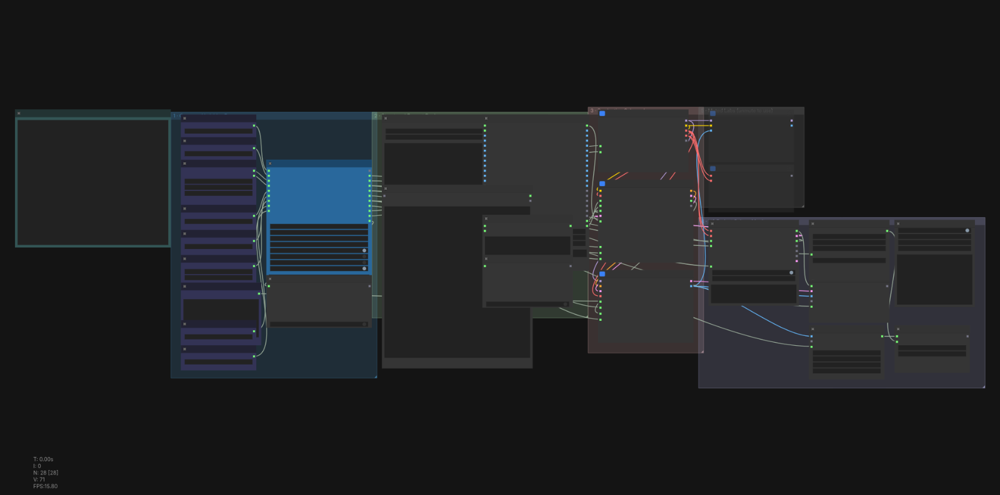
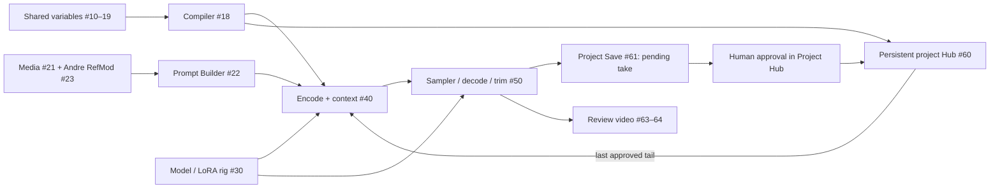

# Master Movie Studio — read-only review

Reviewed the live **The Message - Master Movie Studio** canvas on 2026-11-12, workflow UUID `69ea8e35-eba4-4358-bfe3-63f80fabaa9b`. Root graph identity: `graph:02c49004-b9e2-4485-acfd-b6a3b22a698b`.

**Verdict: useful reusable shot-authoring foundation; production automation needs corrections before relying on it for the movie.** The separation into model, conditioning and sampling subgraphs is sensible. Shared render controls, structured REF prompts, existing Andre identity, project take history and a passive recorder are present. Movie-level shot selection, transition policy, duration accounting and experiment provenance remain incomplete.

This review changed no workflow settings, node wiring, extension source, models or launch flags. No prompt was queued.

## Actual execution and ownership

The root contains **28 nodes, five groups and five embedded subgraphs**. The active flattened graph contains **38 backend nodes / 32 types**. Labs 70 and 80 are muted; Stage Save and Audio Decode are muted internally.

This executes one current prompt at a time. The six shot prompts exist in the prompt library, but they are not six interdependent executable shot records on this canvas. Project Suite maintains a continuation chain, with sequential clip/take numbers; it does not choose the next screenplay shot.

## High-priority findings

### F1 — Delivered duration changes after the first approved clip

**Location:** compiler #18 → conditioning subgraph #40 / H3 Context #83 → sampler subgraph #50 / H3 Context Trim #8.

The compiler calculates raw H3-aligned frames from duration. It does not receive or account for overlap. At the current 3 s / 24 fps setting it requests 73 frames. An empty project leaves context disabled, delivering 73 frames (3.042 s). Once a predecessor is approved, H3 Context pins and trims 22 head frames: **73 − 22 = 51 delivered frames (2.125 s)**. The production summary still advertises 73 frames.

**Correction:** make raw frame count and delivered frame count explicit. Resolve cut/continuation first, then allocate any required overlap using the existing H3 duration/grid helpers; preview the actual delivered duration before rendering.

### F2 — Shot Tag does not select the shot package

**Location:** #11 → #18 → filename prefix #62. Prompt #22, media #21, RefMods #23 and seed #16 remain independent.

Changing `MSG_S001_SH05` to another shot ID changes a filename and the summary; it does not choose the corresponding script prompt, media, identity bundle, seed or transition.

**Correction:** one selected shot record should own prompt preset, reference bindings, seed, render preset, transition and output identity.

### F3 — Every approved predecessor automatically enables visual continuation

**Location:** Hub #60.chain_active → #40.chain_active, with context_length=22, anchor_mode=head and seed_head=true.

After approval, the next shot uses the previous clip's latent tail automatically. There is no movie-level Cut / Continue / Alternate take choice.

**Correction:** encode transition policy per shot. Gate visual context independently of whether an approved clip exists.

### F4 — Shared project name can disagree with the review panel's project

**Location:** #10 → #18 → Hub #60.project_name.

Backend execution receives the linked project string. The ProjectModal reads the Hub's own `project_name` widget.

**Correction:** use one project-name authority that both backend and panel resolve.

### F5 — Monitor cannot distinguish several important experiments

**Location:** Monitor #44; installed `workflow_monitor/model.py:capture_prompt`.

The capture whitelist omits shared primitive `value` fields, Prompt Builder `prompt_text`/`builder_state`, and Fantastic LoRA `lora_data`. Downstream values are recorded as unresolved links.

**Correction:** capture safe snapshots/digests of these real input fields and attach shot/take/transition metadata at the owning boundary.

## Medium-priority findings (deferred after F1–F5)

- **F6** — CPU reference map is informational, not a preflight gate
- **F7** — Audio cannot be enabled by simply unmuting its decoder
- **F8** — Labs are unfinished and should stay muted
- **F9** — Controls overlap substantially
- **F10** — FPS control overstates what the pipeline synchronizes

## Recommended order

1. Fix delivered-duration calculation and Cut/Continue policy together.
2. Make selected shot package and project identity authoritative across controls, review and persistence.
3. Add an explicit CPU preflight and close the monitor provenance gaps.
4. Repair layout and correct the “unmute to use” instructions; retain incomplete labs as disabled.
5. Validate one fresh shot and one explicitly approved continuation in an isolated test project.
6. Only then qualify multi-shot execution, delivery assembly and controlled preset optimization.

**Release recommendation:** retain this as a draft authoring workbench. Resolve F1–F5 and confirm the operation-level tests before calling it a reliable master movie automation workflow.
