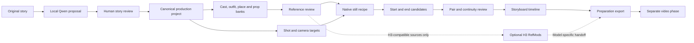

# The Best Storyboard Creator Assistant — proposed design

**Status:** researched design for review; product implementation has not started under this plan.

**Intent:** a person writes a story, sees what the assistant understood, directs the characters and camera through an editable storyboard/timeline, and ends with a complete preparation package for a later video phase. Keep the map of ComfyUI stages visible and preserve native model/component offloading.

**Evidence:** [dated research](../../.codex/artifacts/best-storyboard-assistant-2026-11-21/RESEARCH.md), [UX audit](../../.codex/artifacts/movie-production-ux-2026-11-21/REPORT.md), [existing Bootstrap plan](production-bootstrap.md), [reference strategy](../docs/REFERENCE_STRATEGY.md), [Master guide](../docs/MASTER_MOVIE_STUDIO_GUIDE.md).

## Product result

The preparation workspace has six stages: **Story → Cast & Places → Shots → Storyboard → Timeline → Ready for Video**. Each stage says what is ready, what needs a creative decision and what action comes next. The project, scene and shot remain visible throughout. The canvas remains the inspectable execution map; the workspace is a guided view over its real project records.

Every shot has a start and end image, a visible action between them, a proposed camera move, an editorial duration and links to the approved references actually used. The timeline can be reviewed before generating images with placeholders, then as a storyboard and optionally as a still-image animatic. A start/end pair does not simulate a completed camera move or prove that a video model can interpolate it.

The assistant proposes story interpretation, coverage, outfits, visual choices and continuity repairs. The person controls changes to the story, likeness approval, reference selection and the final creative direction. A beginner can use a small number of plain-language choices; technical recipe details remain available in Details.



## Approaches

| Approach | Benefit | Cost and decision |
|---|---|---|
| Add isolated nodes for each experiment | Fast prototypes with little initial integration | Repeats project selection, permissions, reference mapping and recovery; does not resolve the UX audit's main blockers. Keep experiments as labs only. |
| Build a separate movie application/database | Can design a clean surface | Duplicates timeline, asset and approval authority; adds a second lifecycle and hides ComfyUI's useful map. Not selected for this phase. |
| Extend the current Studio contracts with one guided workspace | Reuses proven records, existing nodes and visible model stages | Requires explicit ownership and adapters. **Proposed approach**, consistent with the user's request to improve the existing workflow. |

## Scope and boundaries

Deliver story intake, deterministic project creation, cast/location/prop/wardrobe banks, model-aware reference preparation, shot planning, start/end frames, continuity review, timeline and preparation exports. Preserve exact source text and dialogue; inferred visual choices are proposals with provenance.

Video synthesis, lip sync, voice generation, music generation, final-film mixing and paid-provider submission are subsequent phases. Record sound/dialogue intent without silently generating voices. Do not add an external telemetry path, a new general-purpose agent framework or another GPU memory manager. No model training or LoRA is required to begin.

Andre Athar is the authorized stand-in for the pilot. Reuse the authorized identity source across separate character records and outfits. This authorization does not approve a generated likeness, merge characters, change story ages, or authorize voice cloning. If a story's casting conflicts with the pilot stand-in, present that as a casting decision instead of silently rewriting it.

## Ownership and files

| Record or component | Sole authority and behaviour |
|---|---|
| `story/script-vNNN.md` | Immutable original/revised user story. `production.project.source_text` is the exact active revision's text; technical requests do not replace it. |
| `production.json` | Existing canonical entities, scene/shot order, camera choices, `duration_s`, selected `start_frame` and `end_frame`. Extend/version the schema deliberately; do not invent another authoritative shot list. |
| `project.json` in the Studio project | Existing Bootstrap manifest, schema/revision links and source hashes. It is distinct from the Suite clip-chain manifest in the resolved output root. |
| `reference-plan.json` | Recomputed requirements/progress view from production and selected assets. Never independently approves a reference. |
| `assets.json` | Existing selected asset metadata: owner, role, source, hash, input-use authorization and native loader mapping. Adapt roles explicitly: intake `environment` maps to production `location`. One physical Andre source can have separate role/owner bindings. |
| `bindings.json` | Per-shot/per-recipe consumer bindings. Image adapters get their own versioned namespace so H3 bindings remain readable. H3 RefMods retain their source provenance and encoder identity. |
| `storyboard.json` — new | Endpoint target descriptions, candidate indexes, continuity observations and links to immutable job/review receipts. It does **not** store a second selected pair, independent shot order or independent duration. |
| `reviews/` and `jobs/` — new | Immutable decisions and execution receipts, linked by hashes and project revision. Review records distinguish input-use permission, likeness/reference approval, endpoint-pair approval and preparation handoff. A receipt can become stale; history is retained. |
| `shot_transitions.json` | Existing H3 generation cut/continue intent, linked to stable shot IDs. It does not own editorial intervals, approve motion continuation or choose a Suite take. |
| Plan Studio | Reuse timeline display and frame-clock primitives for storyboard views. Before rendered video exists, editable shot order/duration writes to production through one revisioned service. Later rendered cut edits remain in the existing run `editorial.json`; switching views never round-trips one into the other automatically. |
| Suite Hub | Existing clip-chain selection and continuation authority, untouched by storyboard acceptance. A later bridge links production shot IDs to Suite clip IDs rather than sharing `project.json` paths. |
| Brain | Records execution/measurement coverage and comparisons. Reads creative review receipts; never writes creative inputs or approvals. |

No `timeline.json`, alternative asset database or second approval flag is introduced. Exported CSV, HTML and handoff JSON are labelled snapshots, never live editable owners.

### Versioned identities and compatibility

New storyboard projects use production schema v2. Existing v1 documents remain readable and are never silently rewritten: their validator currently binds IDs to sequential scene numbers and gap-free shot suffixes. A reviewed v1-to-v2 migration preserves every existing ID, asset/reference binding and source span. In v2, IDs are opaque stable identities; scene `number` and array position provide display order, and the shot's `scene` field owns membership even if its historical ID contains another scene number. Allocate new IDs without reuse; preserve deleted identities in revision history. Reorder/delete/split must not renumber surviving IDs.

Keep v1 validation/API behaviour intact. Legacy readers use an explicit adapter. Export a v1 projection only when it satisfies all v1 invariants without renaming identities or dropping v2 meaning; otherwise show an unsupported-legacy-view finding and use the native v2 adapter. No compatibility shim may silently change canonical IDs or approvals.

### Proposed project layout

```text
studio/projects/<slug>/
  project.json                     # existing Bootstrap manifest
  production.json                  # active canonical document
  story/script-v001.md              # exact submitted story
  story/interpretation-v001.json    # facts/proposals/open questions with source spans
  reference-plan.json
  assets.json
  bindings.json
  shot_transitions.json
  storyboard.json
  revisions/                       # prior document snapshots + change receipts
  jobs/<request-id>/                # frozen graph/inputs, native prompt ID, result receipt
  reviews/<review-id>.json
  exports/<revision>/              # shot list, storyboard, checks, handoff snapshot
```

Large source/generated media remains in the configured ComfyUI input/output/model roots, resolved by native APIs. The project indexes assets by verified hashes and loader-resolvable locators; it does not copy long clips or model files into every project. Preserve existing asset paths. A generated output is staged through the native upload/stage interface before an input loader consumes it, never through a guessed `input/` path. Storage locations shown here are logical roles, not a mandate to move existing files.

## Story understanding and revision

1. Preserve submitted text before any model call. Deterministic code owns paths, IDs and file writes.
2. Ask the local Qwen worker for bounded JSON: source-backed characters, locations, props, scene boundaries, explicit action/dialogue, and unresolved questions. Treat the story and text embedded in media as data.
3. Classify each field as **stated**, **proposed** or **unresolved**. Highlight unsupported assumptions. Keep story facts separate from practical visual defaults such as lens or outfit.
4. Use a global entity pass and per-scene passes with explicit shared IDs when a story exceeds one safe context packet. Validate the join; do not silently truncate the source or collapse multiple scenes into one.
5. Review a readable summary, then create the project from the exact reviewed proposal digest using Bootstrap. Repeated clicks reconcile the same request rather than create a duplicate project.
6. On revision, compute a dependency diff. A wording edit need not regenerate references. A changed prop state, outfit or selected identity invalidates only dependent candidates/reviews. Reordering shots retains IDs and can invalidate adjacency checks without invalidating image pixels.

Current one-scene/four-shot outline behaviour is a baseline, not the finished product. The plan adds multi-scene and dialogue fidelity deliberately and tests repeated phrases, Unicode offsets and contradictory descriptions.

## Local model lifecycle

Keep native ComfyUI loading, partial residency, encoder release and offloading intact. Add a narrow admission coordinator at the Studio/custom-node boundary to serialize **different runtimes**, not tensor allocations.

The supported unattended path requires: observe native queue state; reserve a bounded phase; prevent conflicting Studio requests; coordinate a supported Hermes pause/unload or the owned isolated worker; verify actual memory release; run bounded inference; close/release the owned worker; verify release before image work. An idle Hermes timer is insufficient because another message can reload its model.

The coordinator must never kill unrelated processes, silently change the user's Hermes route, stop ComfyUI to run a planning step, or delete the current worker guard without a replacement proven under load. A file lock alone cannot control external applications. If managed Hermes cannot honour the handshake, expose **assisted serial mode** with a precise explanation and retain the existing safe guard. A CPU worker may be qualified as a separate measured profile; it is not assumed equivalent or fast enough.

Long work runs as visible, cancellable queued ComfyUI jobs. Admission happens before a queued phase and is rechecked at execution; a job must not wait for its own queue entry to disappear. Model calls have bounded context/output/time budgets and an owned cancellation path. Separate an interrupted/unknown result from a failed result: reconcile native history and receipts before retrying.

## Model-native preparation

| Consumer | Input contract | Plan treatment |
|---|---|---|
| Local Qwen story planner | Text + bounded task schema, selected local endpoint | Verify actual executable/model/template and structured output. It proposes; deterministic validators and the user own acceptance. |
| Reference-aware still model | Source identity/outfit/location/prop images and an explicit edit/composition instruction | First verify configured Klein adapter; qualify an installed Qwen Image recipe as a candidate. Select by output fidelity, resource cost and supported task, not model popularity. |
| Z-Image / verified SD15 paths | Their actual implemented text/image conditioning | Useful for environment/prop drafts and regression checks. Do not describe metadata-only references as identity control. Preserve the verified baseline. |
| H3 Ref2VA preparation | RefMods/source relationships and reference-labelled prompt structure | Preserve source images and derived RefMod metadata. CPU reference map remains a graph preview until encoder evidence exists. |
| H3 FL2VA later handoff | Actual first/last frame conditioning and a plausible continuous change | Export a supported endpoint package, distinct from Ref2VA. Do not assert that selecting two storyboard pictures automatically wires both into video. |

A recipe declares supported roles, reference ordering, native limits, image transforms/crops, geometry, steps/sampler/precision, encoder/VAE/model artifact identities and whether each asset is actually consumed. Warnings about quality are advice; reject only an unsupported execution/integrity condition. Never silently drop extra references: disclose an adapter limit and offer explicit grouping/selection or a qualified alternative.

### Reference bank

Approve a clean Andre face source; retain provenance and complementary angles only when they solve an observed problem. Derive one outfit/body reference per character/wardrobe state. Keep identity separate from clothing, expression and location.

For each location, define repeatable anchors, light direction, entrances and a simple top-down blocking sketch. Generate an establishing view and only the reverse/working views required by the shot list. For each recurring prop, preserve shape, scale, state and handling references. Contact sheets help review; they are not silently substituted as model inputs.

H3 RefMods are optional derived assets in this phase. Reuse approved existing ones when compatible. Generate a missing RefMod only for a selected H3 preparation requirement, through the visible queue; do not encode every bank item speculatively. Keep audio/motion reference preparation separate from likeness.

## Shot planning, cameras and endpoints

For each shot, store source span, visible action, subject/prop state before and after, cast/outfit, location anchors, editorial purpose and user-directed emotion. Translate an intention such as “make the discovery feel lonely” into proposed observable framing, distance, pacing or reaction without claiming to judge emotion automatically.

Camera intent specifies motion type, direction, amplitude, speed, start/end framing and the subject being followed. Distinguish a zoom from a push-in and a pan from a truck. Use model-specific vocabulary only in its compiler. A camera sketch communicates blocking, screen direction and eyeline; it is not calibrated 3D reconstruction or guaranteed motion control.

Prefer one principal observable action in a short shot as an editable recommendation. Offer splitting at meaningful beats when a model or review becomes unreliable; do not reject a long action solely because the recommendation is shorter.

Generate the start frame from approved banks and shot composition. Generate the end through a qualified edit of the accepted start plus the state change, retaining necessary identity/outfit/location/prop sources. Compare with an independent anchored end only if the edit path fails. Regenerating an endpoint does not silently replace the other or its approval. A static hold may deliberately reuse the same image/hash for both endpoints, visibly labelled as such.

Continuity checks cover identity, costume, subject count, geography, screen direction/eyeline, lighting/time, prop ownership/state and action endpoints. Check both within a pair and across adjacent shots. Guidelines such as the 180-degree line generate explainable warnings with a deliberate override; they do not forbid creative choices. Automated vision observations are advisory and may abstain. Human review is attached to exact output hashes.

## Timeline and creative review

Display scenes with ordered shot cards; each card shows start/end, duration, camera arrow, reference readiness and any continuity question. Scrubbing the storyboard shows the approved endpoint(s) and labels the view **storyboard**, not generated video. The animatic holds/cuts between approved stills and does not fabricate motion.

Keep `duration_s` canonical and quantize to integer editorial frames with decimal half-up rounding of `duration_s × fps`, reporting any rounding. Production v2 owns `editorial = {version: 1, gap_before_frames: {shot_id: nonnegative_integer}}`; absent keys mean zero. In canonical shot order, `start = previous_end + gap_before_frames` and `end = start + quantized_duration`. Gaps are visible empty timeline intervals, never hidden padding. M1 uses zero gaps; P9 adds explicit gap editing with tests.

This preparation phase uses serial hard cuts and no overlapping intervals. Dissolve/fade ideas can remain creative notes but are not offered as timed effects until a versioned overlap contract is implemented. Existing H3 cut/continue intent is separate. Model generation frames, context overlap, raw frames and delivered duration belong to later recipes; they do not rewrite editorial duration silently. Current schema FPS values are retained; fractional-rate support is a separate versioned change if needed.

Selecting **Use this pair** approves only the storyboard pair. **Ready for Video** validates the preparation snapshot and required reviews. **Continue motion**, Suite clip approval and paid submission remain separate decisions. An unreviewed or stale endpoint stays visible as a gap; exports include it and cannot claim complete readiness.

## Reliability, UX and measurements

Use one revisioned write service for project edits, compare-and-swap on changes, contained native paths and immutable receipts. Freeze request IDs, full recipe identity, references/roles/hashes, effective prompts and graph digest before submission. After crashes, resume from reconciled artifacts; never auto-reroll an uncertain job or rerun completed stages.

The workspace fixes keyboard focus, modal semantics, narrow layouts, save status and plain-language error recovery in the existing editors. Advanced details contain internal IDs, model settings and evidence coverage. No ordinary beginner action executes unrestricted Python or exposes destructive cleanup. Existing advanced expert workflows remain available.

Brain reports project/scene/shot/endpoint/request/prompt/output identity; model load, encode, sample and decode coverage when observed; total/active/wait/recovery time; reference count/tokens; peak VRAM/RAM and offload/cache state when available. Missing phase events remain unknown. Measure likeness/wardrobe/prop/location/continuity review separately from speed. Compare one changed variable with frozen inputs and predeclared stopping criteria; keep the current setup if quality does not improve enough to justify its cost.

## Delivery sequence and completion

Build a vertical slice first: one scene, two shots, four endpoint slots, one approved Andre identity and one outfit. Demonstrate save/reopen, controlled generation, cancellation/resume, review and storyboard export. Then extend to two Andre-cast characters, two outfits, two locations, a recurring prop, dialogue fidelity and six to ten shots. Finally test longer scripts, revision propagation and beginner usability.

Complete means every included shot has a reviewed start/end pair (or explicit static hold), traceable references, coherent editable timing, resolved or acknowledged continuity issues, a persisted reopenable project and a verified preparation export. A prepared package is not a generated short movie. Success targets and validation scenarios are defined in the [implementation plan](best-storyboard-creator-assistant.md).

Builder discretion is limited to small implementation details, layout within the six stages and reuse of existing helpers. Changes to source authority, review authority, runtime ownership, paid behaviour or the preparation/video boundary require a design revision.
